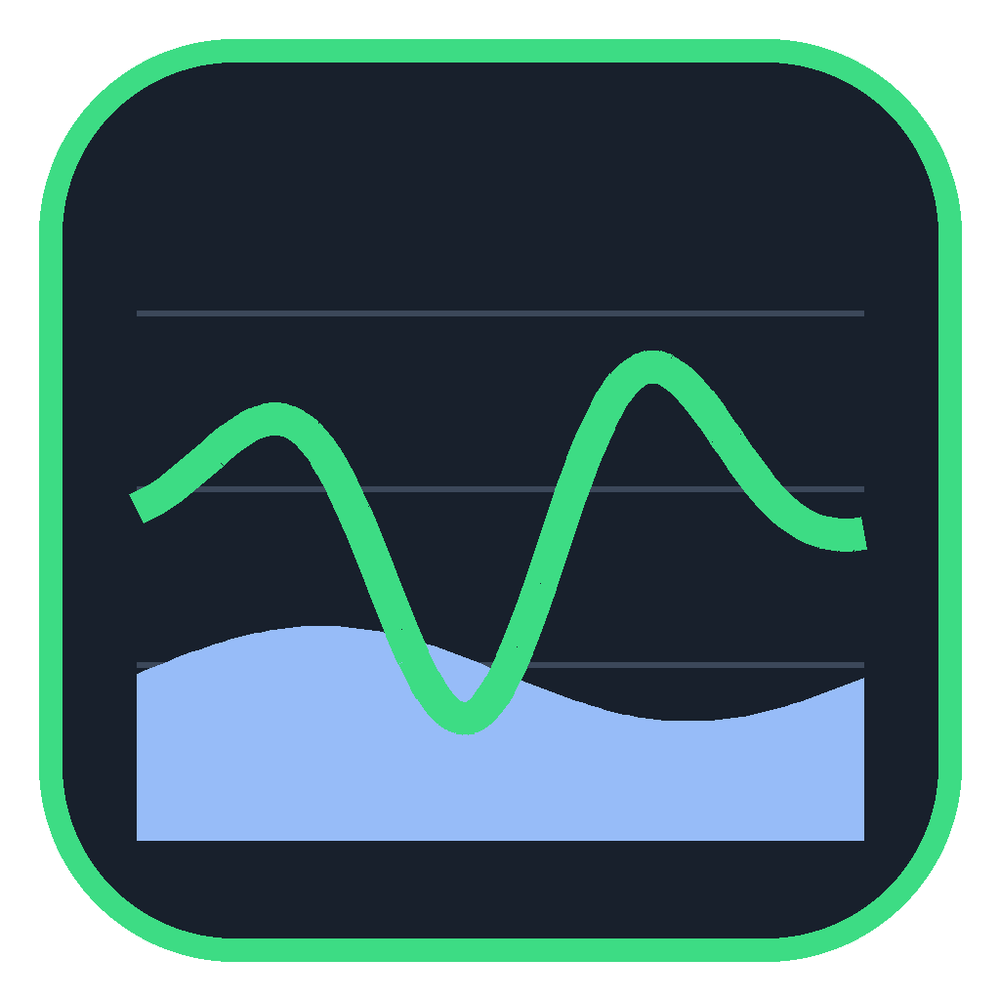
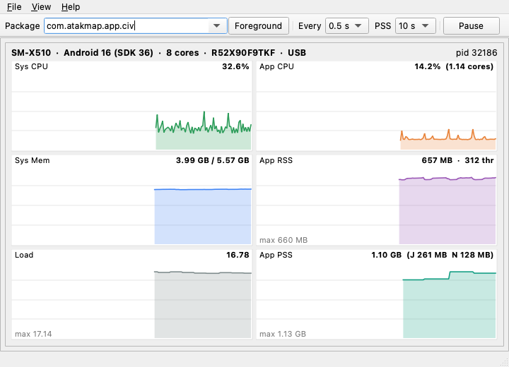

<table border="0">
  <tr>
    <td>
      <!-- VERSION -->v6.11.19<br>
      <!-- DATE -->19-Nov-2026<br>
      macOS &nbsp;|&nbsp; Windows &nbsp;|&nbsp; Linux<br>
      <a href="https://landenlabs.com">Home</a>
    </td>
    <td>
      <a href="https://landenlabs.com">
        
      </a>
    </td>
  </tr>
</table>



# ADB Monitor

A small Qt window (plus tray icon) that shows live CPU and memory for every Android
device connected over adb (USB, Wi-Fi or emulator), and for the app you're
developing, at very low overhead on the device.

**By [LanDen Labs](https://github.com/landenlabs) (2026)**

---

## Screenshot



---

## Features

- **All connected devices.** USB, Wi-Fi (`adb connect` / wireless debugging) and
  emulators each get a card. Devices appear and disappear as you plug them in
  or out. Dropped Wi-Fi streams reconnect on their own. Unauthorized devices say so.
- **System metrics.** Whole-device CPU %, used/total memory (MemTotal − MemAvailable)
  and the 1-minute load average.
- **App metrics** for one package. CPU % of the whole device (also shown as
  cores, e.g. `1.08 cores`), RSS, thread count and, optionally, PSS with
  Java/Native heap from `dumpsys meminfo`. Tracking follows the app across
  restarts (new pid).
- **Foreground** button fills in the package of the app currently on screen.
- **Stay on Top**, so the window can sit over Android Studio. **Close to Tray** keeps
  it sampling with the window hidden; the tray tooltip shows a live summary.
- **Export CSV** of every sample collected this session.
- **Console mode** (`--console`) prints one line per sample with no GUI, optionally
  writing a CSV. Useful for scripted test runs.
- Remembers package, intervals, window position and recent packages between runs.

---

## How it keeps overhead low

| Approach | Cost per sample |
|---|---|
| New `adb shell` per command | Process start on the host, adb handshake and fork/exec on the device. Roughly 5–20 ms on USB, more on Wi-Fi |
| **ADB Monitor: one persistent `adb shell` per device** | The device loop reads `/proc` with shell builtins (`read`, `case`). The only fork per sample is `sleep` |
| `dumpsys meminfo <pkg>` (PSS) | ~100–500 ms. It binder-calls into your app and walks its smaps, so it **runs on its own slow timer and is off by default** |

CPU % is computed on the host from `/proc/stat` and `/proc/<pid>/stat` jiffy deltas,
so there's no `top` and no sampling window on the device. The adb shell user can read
other apps' `/proc/<pid>` entries; an app installed on the device can't on Android 8+,
which is why this tool needs no companion app.

---

## Requirements

- Python 3.10 or later
- `pip install -r requirements.txt` (PyQt6)
- Android SDK platform-tools (`adb`). It's found through `ANDROID_HOME`,
  `ANDROID_SDK_ROOT`, `PATH`, then the default SDK location
  (`~/Library/Android/sdk`, `%LOCALAPPDATA%\Android\Sdk`). The tool uses the same
  adb as Android Studio, so the two don't fight over the adb server.

---

## Usage

```
adb-monitor.py                                  # GUI, remembers last settings
adb-monitor.py -p com.example.app               # GUI tracking one app
adb-monitor.py -p com.example.app --pss 30      # add PSS every 30 s
adb-monitor.py --console -p com.example.app -i 0.5 -d 60 --csv run.csv
```

| Option | Meaning |
|---|---|
| `-p`, `--package PKG` | App package to track (blank = system only) |
| `-i`, `--interval S` | Sample interval: `0.5`, `1` (default), `2`, `5` seconds |
| `--pss SECS` | `dumpsys meminfo` interval, `0` = off (default) |
| `--adb PATH` | Explicit adb path |
| `-c`, `--console` | No GUI; print one line per sample |
| `-d`, `--duration S` | Console mode: stop after S seconds (default: until Ctrl-C) |
| `--csv FILE` | Console mode: write samples to CSV on exit |
| `-V`, `--version` | Print version |

Console output:

```
# device R52X90F9TKF  device  USB
14:20:16 R52X90F9TKF      cpu  26.7%  mem   3.97 GB / 5.57 GB   load 17.65  | pid 32186 cpu 13.8% (1.11 cores) rss 637 MB thr 313 pss 1.00 GB
```

---

## Project structure

```
py-adb-monitor/
├── adb-monitor.py              # Main script (single-file GUI + console mode)
├── VERSION                     # Bare X.Y.Z, mirrors the VERSION literal in adb-monitor.py
├── set-version.bash            # Bump version, commit, tag, push (macOS/Linux)
├── set-version.ps1             # Bump version, commit, tag, push (Windows)
├── icon.png                    # App icon: title bar, Dock/taskbar, tray, About dialog, README
├── icon.icns                   # App icon baked into the macOS release build
├── icon.ico                    # App icon baked into the Windows release build
├── make-icons.py               # Regenerate icon.icns/icon.ico from icon.png (Pillow)
├── requirements.txt
├── README.md
├── LICENSE
├── screens/                    # landenlabs_400.webp (About + README) and screenshots
└── .github/workflows/build.yml # Tag-triggered build + GitHub Release
```

---

## Releasing

Versions are bumped with `set-version.bash` (or `set-version.ps1` on Windows), run from
the repo root:

```bash
./set-version.bash -version 6.11.20 -message "Describe the change"
```

This updates `VERSION`, the `VERSION` literal hardcoded in `adb-monitor.py`, and the
version/date markers at the top of this README, then commits, tags and pushes. The
`v*` tag triggers the GitHub Action, which builds a macOS `.app` (zipped) and a
Windows `.exe` and publishes them as a GitHub Release. The in-app "Built" date
(About dialog) comes from `adb-monitor.py`'s own file timestamp, so it tracks the
last version bump.

---

## License

Apache 2.0 © [LanDen Labs](https://github.com/landenlabs) 2026. See [LICENSE](LICENSE).
